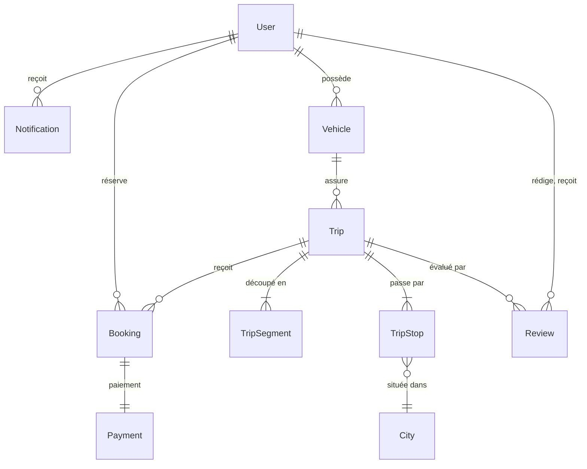
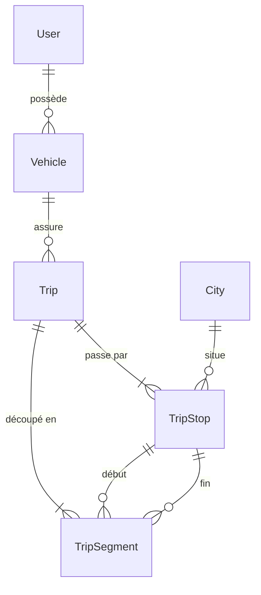
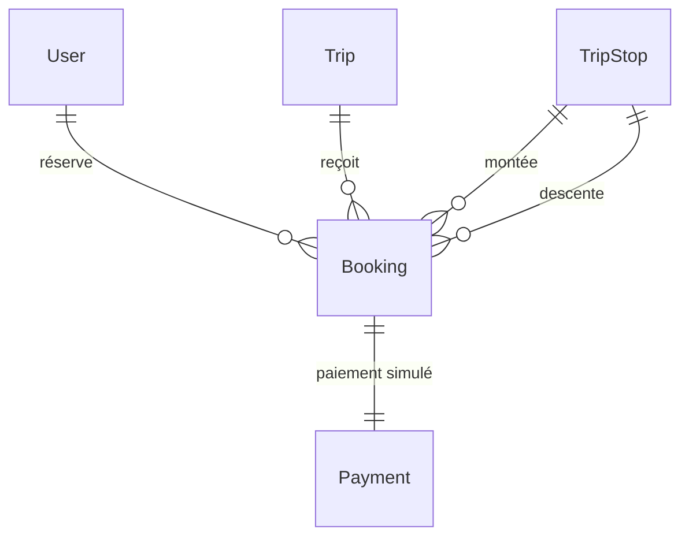
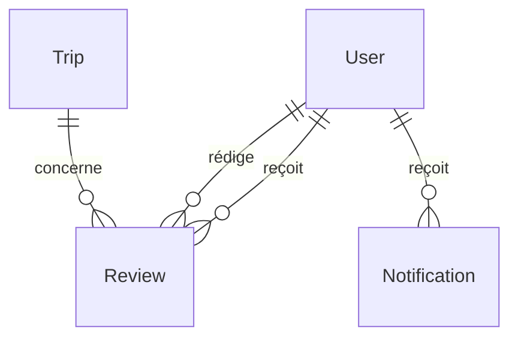

# Modèle de données

Ce document présente le modèle de données et explique ses choix. Les règles métier et leurs justifications figurent dans [DECISIONS.md](DECISIONS.md).

**Sommaire**

1. [Vue d'ensemble](#1-vue-densemble)
2. [Diagrammes par domaine](#2-diagrammes-par-domaine)
3. [Dictionnaire des données](#3-dictionnaire-des-données)
4. [Choix de conception](#4-choix-de-conception)
5. [Contraintes en base](#5-contraintes-en-base)

---

## 1. Vue d'ensemble



Cette vue montre les entités et leurs liens principaux. Les liens entre étapes, segments et réservations, ainsi que les attributs, sont détaillés plus bas.

| Domaine | Entités | Rôle |
|---|---|---|
| Comptes | `User`, `Vehicle` | Compte unique pour conducteurs et passagers ; véhicules des conducteurs. |
| Offre | `City`, `Trip`, `TripStop`, `TripSegment` | Trajets publiés, leurs étapes et les tronçons qui les relient. |
| Réservation | `Booking`, `Payment` | Réservation d'une portion de trajet et paiement simulé associé. |
| Après le trajet | `Review`, `Notification` | Avis entre passagers et conducteurs ; messages dans l'espace passager. |

**Lecture des liens :** deux traits pour exactement un ; un cercle et une patte d'oie pour zéro ou plusieurs ; un trait et une patte d'oie pour un ou plusieurs.

---

## 2. Diagrammes par domaine

### Offre de trajets

Un conducteur assure des trajets avec l'un de ses véhicules. Chaque segment relie deux étapes consécutives.



### Réservation et paiement

Une réservation porte sur une portion définie par une étape de montée et une étape de descente.



### Avis et notifications

Un avis relie un auteur et un destinataire pour un trajet donné.



---

## 3. Dictionnaire des données

Toutes les tables ont une clé primaire `id` (`INT`, auto-incrémentée). Une colonne est obligatoire sauf mention « oui » dans la colonne *Nul*.

### `app_user` — entité `User`

| Colonne | Type | Nul | Description |
|---|---|---|---|
| `email` | `VARCHAR(180)` | | Identifiant de connexion, unique |
| `password` | `VARCHAR(255)` | | Mot de passe haché |
| `roles` | `JSON` | | Rôles du compte |
| `first_name` | `VARCHAR(100)` | | Prénom |
| `last_name` | `VARCHAR(100)` | | Nom |
| `created_at` | `DATETIME` | | Date de création |

### `city` — entité `City`

| Colonne | Type | Nul | Description |
|---|---|---|---|
| `name` | `VARCHAR(100)` | | Nom de la ville, unique |

### `vehicle` — entité `Vehicle`

| Colonne | Type | Nul | Description |
|---|---|---|---|
| `owner_id` | `INT` → `app_user` | | Propriétaire, donc conducteur |
| `brand` | `VARCHAR(60)` | | Marque |
| `model` | `VARCHAR(60)` | | Modèle |
| `passenger_seats` | `INT` | | Places proposables, hors conducteur |

### `trip` — entité `Trip`

| Colonne | Type | Nul | Description |
|---|---|---|---|
| `vehicle_id` | `INT` → `vehicle` | | Véhicule utilisé |
| `seat_capacity` | `INT` | | Places proposées sur chaque segment |
| `full_price_cents` | `INT` | | Prix d'une place pour le trajet complet, en centimes de MAD |
| `status` | `VARCHAR(20)` | | `published`, `completed` ou `cancelled` |
| `itinerary_frozen_at` | `DATETIME` | oui | Date du gel de l'itinéraire |
| `cancellation_reason` | `LONGTEXT` | oui | Motif d'annulation par le conducteur |
| `cancelled_at` | `DATETIME` | oui | Date d'annulation |
| `completed_at` | `DATETIME` | oui | Date à laquelle le trajet est marqué effectué |
| `created_at` | `DATETIME` | | Date de création |

### `trip_stop` — entité `TripStop`

| Colonne | Type | Nul | Description |
|---|---|---|---|
| `trip_id` | `INT` → `trip` | | Trajet |
| `city_id` | `INT` → `city` | | Ville, utilisée pour la recherche |
| `position` | `INT` | | Rang dans le trajet, à partir de 0 |
| `meeting_address` | `VARCHAR(255)` | | Adresse précise du point de rendez-vous |
| `latitude` | `DECIMAL(9,6)` | | Latitude |
| `longitude` | `DECIMAL(9,6)` | | Longitude |
| `arrival_at` | `DATETIME` | oui | Arrivée prévue ; absente pour la première étape |
| `departure_at` | `DATETIME` | oui | Départ prévu ; absent pour la dernière étape |

### `trip_segment` — entité `TripSegment`

| Colonne | Type | Nul | Description |
|---|---|---|---|
| `trip_id` | `INT` → `trip` | | Trajet |
| `from_stop_id` | `INT` → `trip_stop` | | Étape de début |
| `to_stop_id` | `INT` → `trip_stop` | | Étape de fin |
| `position` | `INT` | | Rang du segment, à partir de 0 |
| `distance_meters` | `INT` | | Distance routière en mètres |

### `booking` — entité `Booking`

| Colonne | Type | Nul | Description |
|---|---|---|---|
| `trip_id` | `INT` → `trip` | | Trajet |
| `passenger_id` | `INT` → `app_user` | | Passager |
| `boarding_stop_id` | `INT` → `trip_stop` | | Étape de montée |
| `alighting_stop_id` | `INT` → `trip_stop` | | Étape de descente |
| `seats` | `INT` | | Nombre de places |
| `seat_price_cents` | `INT` | | Prix d'une place pour cette portion, figé à la réservation |
| `total_price_cents` | `INT` | | Montant total, figé à la réservation |
| `status` | `VARCHAR(20)` | | `confirmed` ou `cancelled` |
| `created_at` | `DATETIME` | | Date de réservation |
| `cancelled_at` | `DATETIME` | oui | Date d'annulation |

### `payment` — entité `Payment`

| Colonne | Type | Nul | Description |
|---|---|---|---|
| `booking_id` | `INT` → `booking` | | Réservation, unique |
| `amount_cents` | `INT` | | Montant en centimes |
| `status` | `VARCHAR(20)` | | `paid` ou `refunded` |
| `paid_at` | `DATETIME` | | Date du paiement simulé |
| `refunded_at` | `DATETIME` | oui | Date du remboursement simulé |

### `review` — entité `Review`

| Colonne | Type | Nul | Description |
|---|---|---|---|
| `trip_id` | `INT` → `trip` | | Trajet concerné |
| `author_id` | `INT` → `app_user` | | Auteur de l'avis |
| `target_id` | `INT` → `app_user` | | Personne évaluée |
| `rating` | `INT` | | Note de 1 à 5 |
| `comment` | `LONGTEXT` | oui | Commentaire |
| `created_at` | `DATETIME` | | Date de dépôt |

### `notification` — entité `Notification`

| Colonne | Type | Nul | Description |
|---|---|---|---|
| `recipient_id` | `INT` → `app_user` | | Destinataire |
| `message` | `LONGTEXT` | | Message |
| `is_read` | `TINYINT` | | État de lecture |
| `created_at` | `DATETIME` | | Date de création |

---

## 4. Choix de conception

### Le segment comme unité de calcul

Un trajet de N étapes comporte N − 1 segments. Le segment de rang `p` relie l'étape de rang `p` à l'étape de rang `p + 1`. Une réservation couvre les segments dont le rang est compris entre le rang de son étape de montée (inclus) et le rang de son étape de descente (exclu).

L'occupation d'un segment se déduit donc des réservations confirmées :

```text
occupation(p) = somme des places des réservations confirmées
                où rang(montée) <= p et rang(descente) > p
```

Exemple sur Agadir – Marrakech – Casablanca : une réservation Agadir – Marrakech occupe le segment 0 et laisse le segment 1 libre.

Il n'y a **ni table de liaison réservation–segment, ni compteur de places** : l'occupation a une seule source, les réservations, et ne peut pas diverger. Le calcul et le verrouillage sont détaillés dans [DECISIONS.md](DECISIONS.md).

### Le conducteur n'est pas stocké sur le trajet

Le conducteur d'un trajet est le propriétaire de son véhicule (`Trip::getDriver()`). Une colonne supplémentaire ferait exister la même information deux fois, avec un risque d'incohérence.

### Montants et distances en entiers

Les montants sont en centimes de MAD et les distances en mètres, tous stockés en entiers : aucun calcul monétaire n'utilise la virgule flottante. La réservation conserve le prix d'une place et le total, si bien qu'un changement ultérieur du prix complet ne la modifie pas.

### Gel de l'itinéraire

`trip.itinerary_frozen_at` est renseignée dans la transaction de la première réservation confirmée et n'est jamais remise à zéro. Le gel reste donc acquis même si les réservations sont annulées ou si une ligne de réservation est supprimée.

### Conservation de l'historique

Les clés étrangères n'ont pas de suppression en cascade au niveau de la base : un compte, un véhicule ou un trajet référencé par des réservations ne peut pas être supprimé. Les annulations sont des changements d'état, pas des suppressions.

### Coordonnées géographiques

Les coordonnées sont en `DECIMAL(9,6)`, ce qui couvre toute la plage de longitude avec une précision d'environ 10 cm.

### Horaires

Les horaires sont stockés à l'heure du Maroc (`Africa/Casablanca`), fuseau configuré pour PHP.

---

## 5. Contraintes en base

### Unicité

Déclarée dans les entités.

| Table | Colonnes uniques |
|---|---|
| `app_user` | `email` |
| `city` | `name` |
| `trip_stop` | `trip_id`, `position` |
| `trip_segment` | `trip_id`, `position` |
| `payment` | `booking_id` |
| `review` | `trip_id`, `author_id`, `target_id` |

### Contrôles `CHECK`

Ils portent uniquement sur la validité d'une ligne et sont ajoutés dans la migration, car Doctrine ne les génère pas.

| Table | Contrôle |
|---|---|
| `vehicle` | `passenger_seats > 0` |
| `trip` | `seat_capacity > 0`, `full_price_cents > 0` |
| `trip_stop` | `position >= 0` ; latitude entre −90 et 90 ; longitude entre −180 et 180 ; au moins un horaire renseigné ; départ postérieur ou égal à l'arrivée |
| `trip_segment` | `position >= 0`, `distance_meters > 0`, étapes de début et de fin différentes |
| `booking` | `seats > 0` ; montants positifs ou nuls ; `total_price_cents = seat_price_cents * seats` ; étapes de montée et de descente différentes |
| `payment` | `amount_cents >= 0` |
| `review` | `rating` entre 1 et 5 ; auteur et destinataire différents |

### Règles portées par le code métier

Les règles qui concernent plusieurs lignes sont appliquées dans le code métier : disponibilité des places, ordre des étapes d'une réservation, réservation active unique par passager et par trajet.
