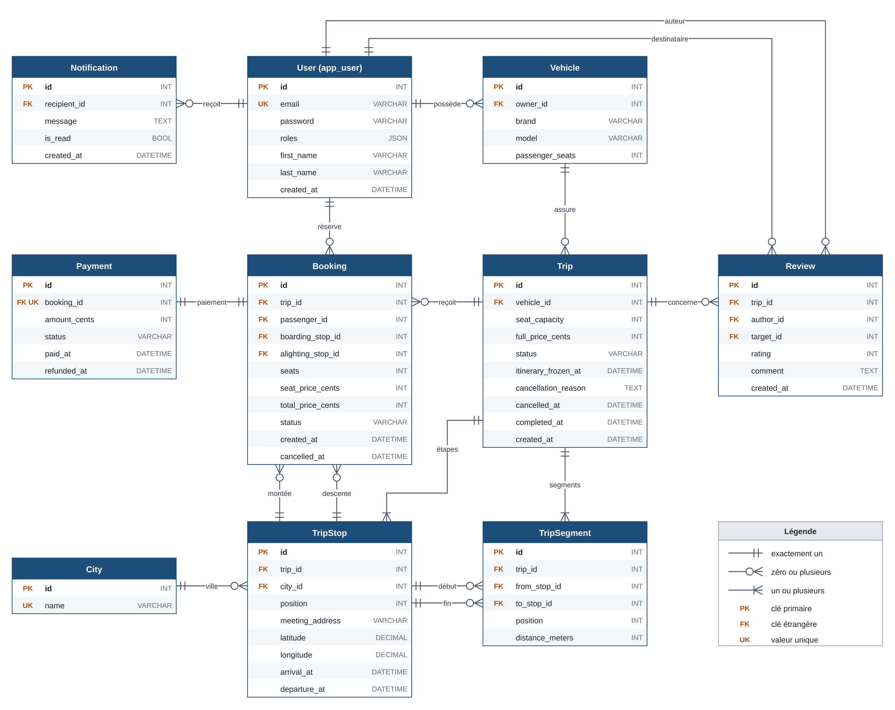

# Modèle de données

Ce document présente le modèle de données et explique ses choix. Les règles métier et leurs justifications figurent dans [DECISIONS.md](DECISIONS.md).

## Diagramme entité-association



Le diagramme montre les dix tables, toutes leurs colonnes et leurs seize relations. Les types y sont simplifiés ; les longueurs exactes figurent dans les entités Doctrine. La source modifiable est [modele-donnees.drawio](modele-donnees.drawio).

## Entités

Chaque entité correspond à une table au nom en `snake_case`, à l'exception de `User`, stockée dans `app_user`.

| Domaine | Entité | Rôle |
|---|---|---|
| Comptes | `User` | Compte unique, avec des rôles. Une même personne peut être conducteur et passager. |
| | `Vehicle` | Véhicule d'un conducteur et nombre de places proposables, hors conducteur. |
| Offre | `City` | Ville de la liste gérée depuis le back-office ; sert à la recherche. |
| | `Trip` | Trajet publié : véhicule, capacité, prix complet, état et gel de l'itinéraire. |
| | `TripStop` | Étape : ville, rang, point de rendez-vous, coordonnées, horaires. |
| | `TripSegment` | Tronçon entre deux étapes consécutives, avec sa distance en mètres. |
| Réservation | `Booking` | Réservation d'une ou plusieurs places entre une étape de montée et une étape de descente. |
| | `Payment` | Paiement simulé d'une réservation : payé, puis éventuellement remboursé. |
| Après le trajet | `Review` | Avis dans un sens donné, pour un trajet. |
| | `Notification` | Message affiché dans l'espace passager. |

## Choix de conception

### Le segment comme unité de calcul

Un trajet de N étapes comporte N − 1 segments. Le segment de rang `p` relie l'étape de rang `p` à l'étape de rang `p + 1`. Une réservation couvre les segments dont le rang est compris entre le rang de son étape de montée (inclus) et le rang de son étape de descente (exclu).

L'occupation d'un segment se déduit donc des réservations confirmées :

```text
occupation(p) = somme des places des réservations confirmées
                où rang(montée) <= p et rang(descente) > p
```

Exemple sur Agadir – Marrakech – Casablanca : une réservation Agadir – Marrakech occupe le segment 0 et laisse le segment 1 libre.

Il n'y a **ni table de liaison réservation–segment, ni compteur de places** : l'occupation a une seule source, les réservations, et ne peut pas diverger. Le calcul et le verrouillage sont détaillés dans [DECISIONS.md](DECISIONS.md).

### Le conducteur n'est pas stocké sur le trajet

Le conducteur d'un trajet est le propriétaire de son véhicule (`Trip::getDriver()`). Une colonne supplémentaire ferait exister la même information deux fois, avec un risque d'incohérence.

### Montants et distances en entiers

Les montants sont en centimes de MAD et les distances en mètres, tous stockés en entiers : aucun calcul monétaire n'utilise la virgule flottante. La réservation conserve le prix d'une place et le total, si bien qu'un changement ultérieur du prix complet ne la modifie pas.

### Gel de l'itinéraire

`trip.itinerary_frozen_at` est renseignée dans la transaction de la première réservation confirmée et n'est jamais remise à zéro. Le gel reste donc acquis même si les réservations sont annulées ou si une ligne de réservation est supprimée.

### Conservation de l'historique

Les clés étrangères n'ont pas de suppression en cascade au niveau de la base : un compte, un véhicule ou un trajet référencé par des réservations ne peut pas être supprimé. Les annulations sont des changements d'état, pas des suppressions.

### Coordonnées et horaires

Les coordonnées sont en `DECIMAL(9,6)`, ce qui couvre toute la plage de longitude avec une précision d'environ 10 cm. Les horaires sont stockés à l'heure du Maroc (`Africa/Casablanca`), fuseau configuré pour PHP. La première étape n'a pas d'heure d'arrivée et la dernière n'a pas d'heure de départ.

## Contraintes en base

Les contraintes d'unicité sont déclarées dans les entités et marquées `UK` sur le diagramme, ou portent sur plusieurs colonnes :

| Table | Colonnes uniques ensemble |
|---|---|
| `trip_stop` | `trip_id`, `position` |
| `trip_segment` | `trip_id`, `position` |
| `review` | `trip_id`, `author_id`, `target_id` |

Les contrôles `CHECK` portent uniquement sur la validité d'une ligne et sont ajoutés dans la migration, car Doctrine ne les génère pas :

| Table | Contrôle |
|---|---|
| `vehicle` | `passenger_seats > 0` |
| `trip` | `seat_capacity > 0`, `full_price_cents > 0` |
| `trip_stop` | `position >= 0` ; latitude entre −90 et 90 ; longitude entre −180 et 180 ; au moins un horaire renseigné ; départ postérieur ou égal à l'arrivée |
| `trip_segment` | `position >= 0`, `distance_meters > 0`, étapes de début et de fin différentes |
| `booking` | `seats > 0` ; montants positifs ou nuls ; `total_price_cents = seat_price_cents * seats` ; étapes de montée et de descente différentes |
| `payment` | `amount_cents >= 0` |
| `review` | `rating` entre 1 et 5 ; auteur et destinataire différents |

Les règles qui concernent plusieurs lignes sont appliquées dans le code métier : disponibilité des places, ordre des étapes d'une réservation, réservation active unique par passager et par trajet.
